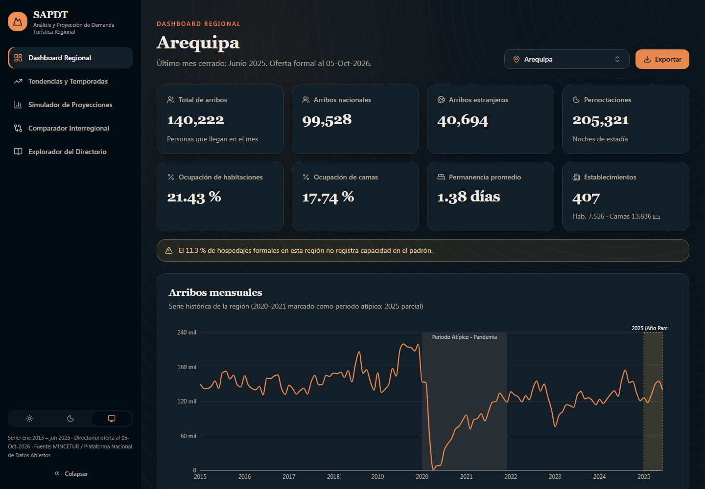
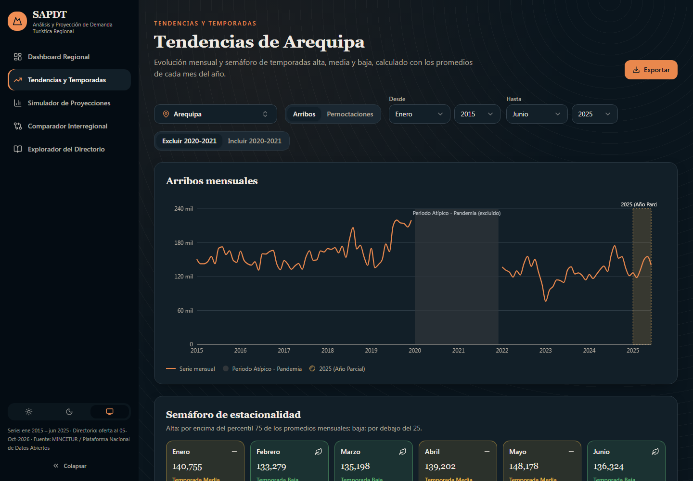
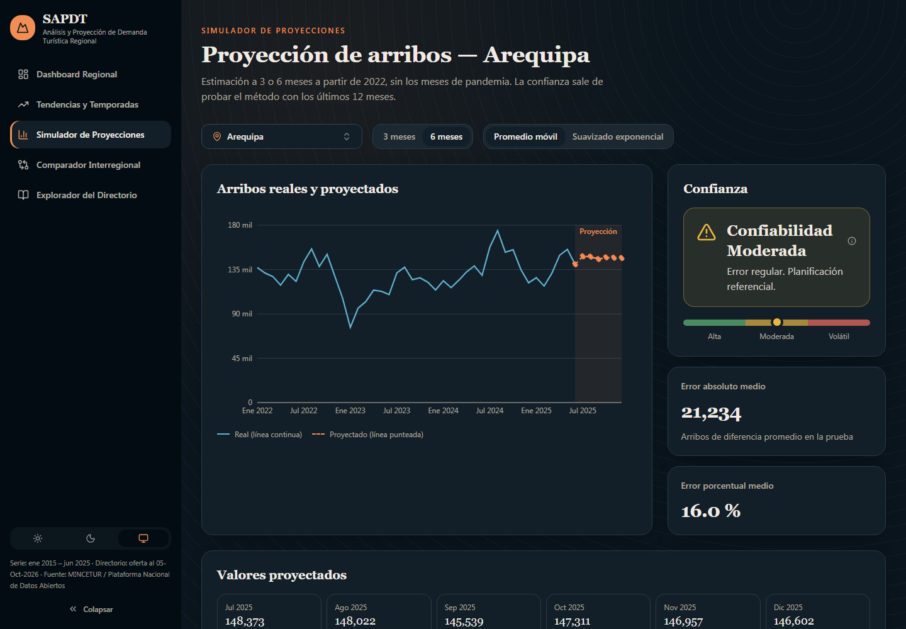
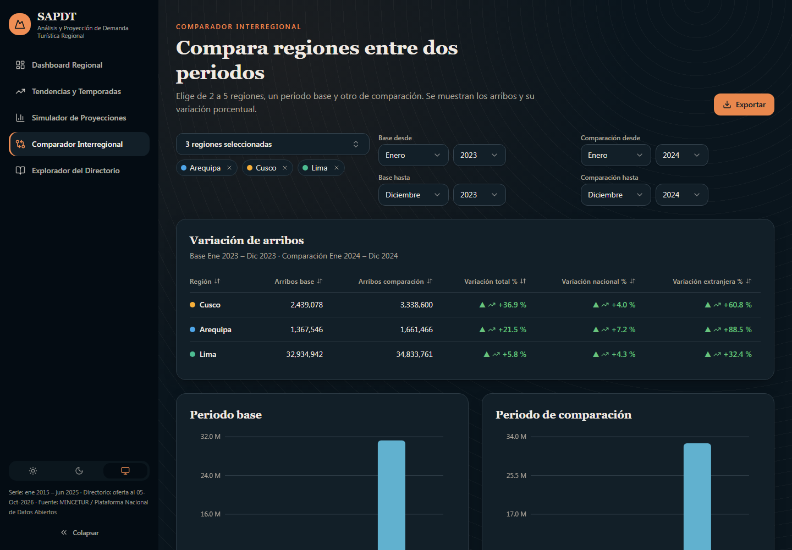

# SAPDT — Sistema de Análisis y Proyección de Demanda Turística Regional


**¿Cuántos turistas llegarán a mi región en los próximos meses? ¿Cuándo es temporada alta? ¿Hay suficientes hospedajes?**
SAPDT responde estas preguntas con datos abiertos y reales del MINCETUR: más de 10 años de ocupación hotelera (enero 2015 – junio 2025) y el directorio de 5 000+ establecimientos de hospedaje clasificados del Perú.

### 🌐 Pruébalo en línea: **https://sapdt-web-606560700752.us-central1.run.app**



## ¿Para quién es?
Para gobiernos regionales, cámaras de turismo, hoteleros y emprendedores que necesitan planificar (personal, inversión, promociones) a partir de datos y no de intuición.

## Funcionalidades

| Pantalla | Qué hace |
|---|---|
| 📊 **Dashboard regional** | Indicadores del último mes de cada región: arribos nacionales y extranjeros, pernoctaciones, ocupación de habitaciones y camas, permanencia promedio y oferta de hospedaje. Serie histórica 2015–2025 con la pandemia marcada como periodo atípico. |
| 📈 **Tendencias y temporadas** | Evolución mensual de arribos o pernoctaciones en el rango que elijas, y un semáforo que clasifica cada mes del año en temporada **alta, media o baja** (percentiles 75 y 25). |
| 🔮 **Simulador de proyecciones** | Pronostica los arribos a 3 o 6 meses con promedio móvil o suavizado exponencial, e indica qué tan confiable es la estimación (error medio comprobado con los últimos 12 meses reales). |
| ⚖️ **Comparador interregional** | Compara de 2 a 5 regiones entre dos periodos: arribos y variación porcentual total, nacional y extranjera. |
| 🏨 **Explorador del directorio** | Busca hospedajes formales por región, clase (hotel, hostal, albergue…) y categoría (1 a 5 estrellas), con totales de habitaciones y camas. |
| 📄 **Exportación** | Cada reporte se descarga en **CSV** (abre bien en Excel) o **PDF**. |

<table>
<tr>
<td></td>
<td></td>
</tr>
<tr>
<td align="center">Tendencias y semáforo de temporadas</td>
<td align="center">Proyección con nivel de confianza</td>
</tr>
<tr>
<td colspan="2"></td>
</tr>
<tr>
<td colspan="2" align="center">Comparador interregional</td>
</tr>
</table>

## Calidad de los datos
Los archivos del portal no son uniformes, así que la carga se encarga de eso sin perder nada en silencio:
- Detecta sola la codificación, el separador, el formato de fecha y el cambio de columnas entre años.
- Las filas con errores se guardan en una tabla de **rechazos** con la línea y el motivo; las sospechosas se cargan marcadas.
- Repara 15 filas del directorio que el portal partió mal, solo cuando el resultado es verificable.
- Un reporte de cruce lista las regiones o meses que no coinciden entre las dos fuentes.

Detalle técnico en [`backend/LEEME.md`](backend/LEEME.md).

## Arquitectura

```
Datos abiertos MINCETUR (CSV)
        │  carga, validación y cruce (Python)
        ▼
  SQLite (solo lectura, 14 MB) ──► API REST (Python, sin dependencias) ──► Interfaz web (React)
                                   Cloud Run: sapdt-api                    Cloud Run: sapdt-web
```

- **Backend:** Python con solo la biblioteca estándar (sin instalar nada). API REST con exportación a CSV y PDF.
- **Frontend:** React con TanStack Start, gráficos interactivos, modo claro y oscuro.
- **Nube:** dos servicios en Google Cloud Run que se apagan cuando nadie los usa (costo prácticamente cero). Ver [`DEPLOY.md`](DEPLOY.md).

## Requisitos cubiertos
| Código | Requisito | Estado |
|---|---|---|
| RF-01 | Ingesta y consolidación de datasets heterogéneos | ✅ |
| RF-02 | Cruce geográfico y temporal | ✅ |
| RF-03 | Proyección de demanda a 3–6 meses | ✅ |
| RF-04 | Detección de temporada alta, media y baja | ✅ |
| RF-05 | Reportes comparativos entre regiones | ✅ |
| RF-06 | Filtrado y exploración del directorio | ✅ |
| RF-07 | Visualización de series históricas | ✅ |
| RF-08 | Exportación de reportes (CSV/PDF) | ✅ |

Catálogo completo con criterios de aceptación: [`docs/01_catalogo_requisitos_final.md`](docs/01_catalogo_requisitos_final.md).

## Pruebas
Pruebas automáticas para la carga, el cruce, el análisis, la API y la interfaz:
```
cd backend
python -m tests.test_ingesta
python -m tests.test_cruce
python -m tests.test_analisis
python -m tests.test_api
cd ..\frontend
npm install --legacy-peer-deps
npx vitest run
```

## Probar en local (Windows)
Requiere Python 3 y Node.js. Doble clic en `iniciar.bat`: abre la API (puerto 8000) y la interfaz (http://127.0.0.1:5199).

Para volver a cargar los datos desde los CSV originales:
```
cd backend
python -m sapdt.cargar datos_crudos bd\sapdt.db
python -m sapdt.cruce bd\sapdt.db
```

## Estructura del repositorio
| Carpeta | Contenido |
|---|---|
| `backend/` | Carga, cruce y análisis de datos, API y pruebas. |
| `backend/bd/sapdt.db` | Base de datos ya cargada con los datos reales. |
| `backend/datos_crudos/` | Archivos CSV originales descargados del portal. |
| `frontend/` | Interfaz web. |
| `docs/` | Documentos del Hito 1: requisitos, perfilado de datos, cronograma y diagramas. |

## Equipo
Curso de **Calidad de Software** — Universidad La Salle, Arequipa (2026).

| Integrante | Frente |
|---|---|
| Piero Poblete Andía | Datos: ingesta y normalización |
| Davis Arapa Chua | Datos: cruce por región y mes |
| Katherine Saico Ccahuana | Análisis y proyección |
| Leonardo Pachari Gomez | Producto y reportes |
| Nicolle Lozano Vega | Calidad y documentación |

**Fuente de datos:** MINCETUR, Plataforma Nacional de Datos Abiertos del Perú.
