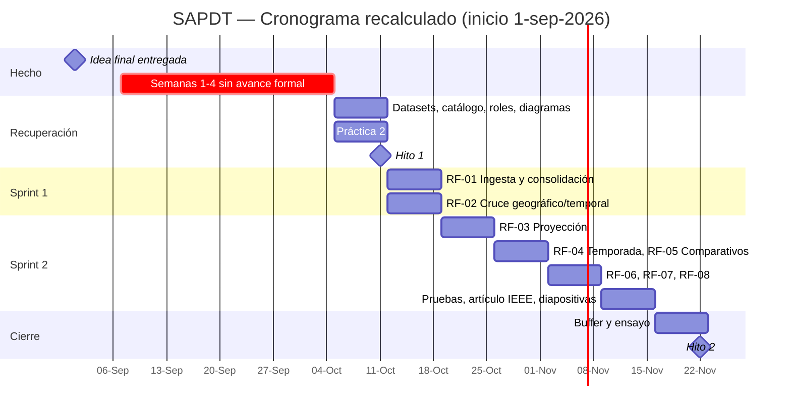

# SAPDT — Cronograma, roles y modelo de proceso (Hito 1)

## 1. Modelo de proceso: Incremental / Scrum adaptado
Justificación (ya validada en las diapositivas):
1. La calidad real de los datos solo se conoce explorándolos → riesgo alto al inicio → se necesita un Sprint 0.
2. Alcance de un semestre con dos hitos de revisión → entregas incrementales verificables.
3. Permite ajustar el catálogo tras cada incremento sin rehacer un plan en cascada.

| Sprint | Contenido | Entrega |
|--------|-----------|---------|
| 0 — Exploración | Perfilado de los 3 datasets, catálogo final, cronograma | Hito 1 |
| 1 — Datos | RF-01 ingesta, RF-02 cruce, diseño de arquitectura | Hito 1 (avance) |
| 2 — Análisis y producto | RF-03 a RF-08, pruebas, artículo IEEE, despliegue | Hito 2 (100%) |

## 2. Estado y calendario base
- **1-sep-2026 (martes):** se entregó la idea final del proyecto → día 0.
- **Semana 1 = lun 7-sep.** Las semanas 1–4 (7-sep → 4-oct) pasaron **sin avance formal**.
- **Hoy, mar 6-oct-2026, es el inicio de la semana 6.**
- El plan de 11 semanas se mantiene: la semana 11 termina el dom 22-nov. Lo perdido se recupera **paralelizando**, no estirando el calendario.

> Fechas de hitos: no están en ningún documento que yo haya visto. Dejé **Hito 1 = dom 11-oct** y **Hito 2 = dom 22-nov** como supuestos `[CONFIRMAR con la profesora]`.

## 3. Cronograma recalculado

| Sem | Fechas (lun–dom) | Estado | Actividad |
|-----|------------------|--------|-----------|
| 0 | 1 → 6-sep | Hecho | Idea final entregada (1-sep) |
| 1–4 | 7-sep → 4-oct | **Perdidas** | (planificado: Sprint 0 y diseño) |
| 5 | 5 → 11-oct | **Recuperación** | Descargar y perfilar datasets, catálogo final, roles, diagramas, Práctica 2 · **Hito 1 (dom 11-oct)** |
| 6 | 12 → 18-oct | Sprint 1 | RF-01 ingesta **en paralelo con** RF-02 cruce (dos personas); despliegue base en nube |
| 7 | 19 → 25-oct | Sprint 2 | RF-03 proyección (promedio móvil + suavizado exponencial) |
| 8 | 26-oct → 1-nov | Sprint 2 | RF-04 temporada; RF-05 comparativos |
| 9 | 2 → 8-nov | Sprint 2 | RF-06 directorio; RF-07 series; RF-08 exportación |
| 10 | 9 → 15-nov | Sprint 2 | Pruebas de integración, artículo IEEE, diapositivas |
| 11 | 16 → 22-nov | Cierre | Buffer, ensayo, **Hito 2 (dom 22-nov)** |

Cambios frente al plan original: RF-01 y RF-02 pasan de las semanas 3–4 a la 6 (en paralelo) y el buffer queda en una sola semana. Si la fecha real del Hito 2 es anterior, recortar primero RF-08 (PDF) y RF-05.

### Diagrama de Gantt (Mermaid — pegar en mermaid.live o en un editor Markdown)

Para entregar el Gantt como imagen: renderizar en mermaid.live y exportar PNG/SVG, o recrearlo en la herramienta CASE/Excel del grupo.

## 4. Roles (combinación A, aprobada por el equipo)
Cinco integrantes y cuatro frentes: el frente de datos lleva dos personas porque concentra el mayor riesgo (RF-01 y RF-02 corren en paralelo desde la semana 6).

| Frente | Responsable | RF | Apoyo / suplente |
|--------|-------------|----|------------------|
| Datos/ingesta | Piero Poblete Andía y Davis Arapa Chua (en pareja: Piero lleva RF-01, Davis lleva RF-02) | RF-01, RF-02 | Se cubren entre sí |
| Análisis/proyección | Katherine Saico Ccahuana | RF-03, RF-04 | Davis (pruebas de RF-03) |
| Producto/reportes | Leonardo Pachari Gomez | RF-05, RF-06, RF-07, RF-08 | Katherine (RF-08) |
| Calidad y documentación | Nicolle Lozano Vega | Pruebas, artículo IEEE, README, coordinación, tablero | Leonardo (pruebas de RF-01) |

Reparto interno del frente de datos (propuesto): Piero = ingesta y normalización por año; Davis = cruce por región/mes y reporte de huérfanos.

## 5. Metodología de trabajo (según la consigna)
- Reunión semanal de seguimiento (15–20 min, mismo día fijo) con acta de 3 líneas: hecho / por hacer / bloqueos.
- Tablero (Trello o Jira) con una tarjeta por RF y columnas Backlog / En curso / En pruebas / Hecho; cada tarjeta enlaza su criterio de aceptación.
- Esfuerzo mínimo del curso: 4 horas diarias por semana según la consigna; registrar horas en el tablero.
- GitHub: ramas `main` / `dev` / `feature/RF-0X`; PR con revisión de al menos 1 compañero.
- Calidad: ISO/IEC 25010 como marco de los RNF.

## 6. Riesgos principales
| Riesgo | Prob. | Impacto | Respuesta |
|--------|-------|---------|-----------|
| Archivo de ocupabilidad 2025 con otro nombre o parcial | Media | Medio | Sacar el enlace del portal (guía de datasets §2.3); si falta, histórico 2015–2024 |
| Esquema cambia entre años | Alta | Medio | Mapeo por año declarado como dato (ver ADR-001) |
| Retraso acumulado (4 semanas perdidas) | Alta | Alto | Hito 1 con alcance mínimo (documentos + datasets perfilados); RF-01/RF-02 en paralelo en semana 6 |
| Calidad desigual en el directorio | Alta | Bajo | Reporte de calidad, no limpieza silenciosa |
