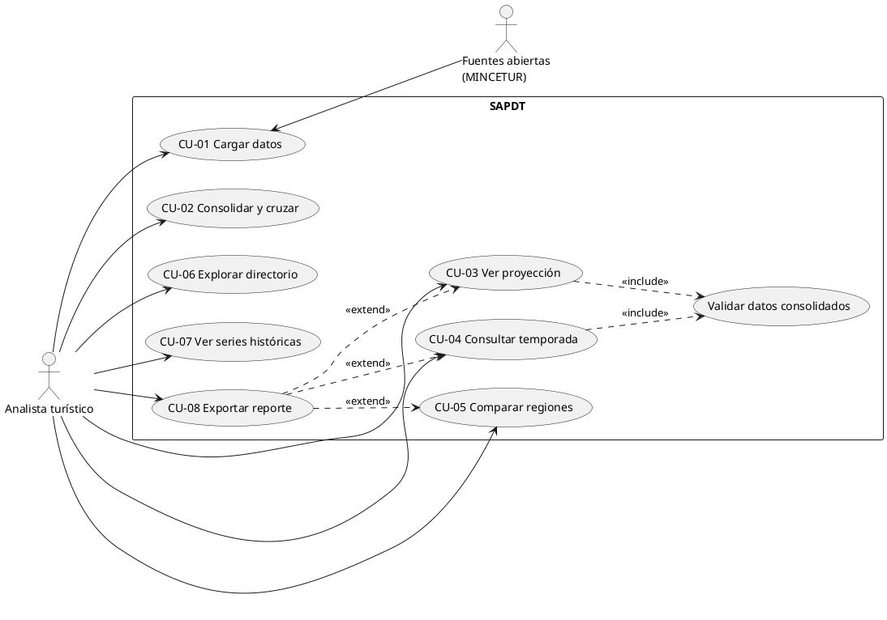
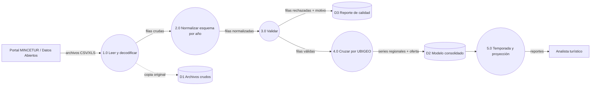

# Guías para lo que se hace a mano (Hito 1)

El hito pide una herramienta CASE (StarUML, Lucidchart, Visual Paradigm o draw.io). Abajo está **qué dibujar, con qué elementos y en qué orden**, más código PlantUML/Mermaid que pueden pegar para tener un borrador y retocarlo. Es un punto de partida, no el entregable final.

## A. Diagrama de casos de uso
**Herramienta:** StarUML → New → Use Case Diagram. (Alternativa: PlantUML en plantuml.com.)

**Pasos**
1. Dibujar el borde del sistema (System Boundary) con el título "SAPDT".
2. Actor principal fuera del borde: **Analista turístico**. Opcional, actor secundario: **Fuentes de datos abiertas** (sistema externo, MINCETUR).
3. Ocho casos de uso, uno por RF, con verbo en infinitivo (CU-01 … CU-08).
4. Relaciones: asociación Analista → cada CU; `<<include>>` de CU-03 y CU-04 hacia "Validar datos consolidados"; `<<extend>>` de "Exportar reporte" hacia comparar/proyectar/temporada.
5. Revisar que cada CU conecte con un RF en la tabla de trazabilidad.



## B. Diagrama de componentes
**Herramienta:** StarUML → Component Diagram.

**Pasos**
1. Cuatro bloques en capas de izquierda a derecha: **Ingesta/ETL → Almacenamiento → Análisis/Proyección → Presentación**.
2. Dentro de Ingesta: `Loader`, `Normalizer`, `Validator`. Dentro de Análisis: `ForecastService`, `SeasonClassifier`, `ReportService`.
3. Interfaces (círculos/paletas): `SeriesRepository`, `ForecastModel`, `ReportFormat` — son los mismos puertos de `practica2/codigo/despues.py`, así se mantiene coherencia con la práctica.
4. Nodos de nube (opcional en este diagrama): Cloud Storage, Cloud SQL, Cloud Run.
5. Flechas de dependencia hacia las interfaces, nunca hacia clases concretas.

```plantuml
@startuml
package "Ingesta/ETL" { [Loader] [Normalizer] [Validator] }
database "Cloud SQL (PostgreSQL)" as DB
cloud "Cloud Storage\n(archivos crudos)" as CS
package "Análisis" { [ForecastService] [SeasonClassifier] [ReportService] }
package "Presentación" { [API REST] [Dashboard web] }
interface SeriesRepository
interface ForecastModel
interface ReportFormat
CS --> [Loader]
[Loader] --> [Normalizer]
[Normalizer] --> [Validator]
[Validator] --> SeriesRepository
SeriesRepository -- DB
[ForecastService] ..> SeriesRepository
[ForecastService] ..> ForecastModel
[ReportService] ..> ReportFormat
[API REST] --> [ForecastService]
[API REST] --> [SeasonClassifier]
[API REST] --> [ReportService]
[Dashboard web] --> [API REST]
@enduml
```

## C. Diagrama de flujo de datos (DFD) del pipeline
**Herramienta:** draw.io o Lucidchart (DFD no es nativo en StarUML estándar; dibujarlo con formas).

**Notación Yourdon/DeMarco:** rectángulos = entidades externas, círculos/rectángulos redondeados = procesos, dos líneas paralelas = almacenes, flechas = flujos con nombre.

**Pasos**
1. Entidades externas: Portal MINCETUR/Datos Abiertos, Analista.
2. Procesos numerados: 1.0 Leer y decodificar archivo → 2.0 Normalizar esquema (por año) → 3.0 Validar y registrar rechazos → 4.0 Cruzar por UBIGEO/región → 5.0 Calcular temporada y proyección.
3. Almacenes: D1 Archivos crudos, D2 Modelo consolidado, D3 Reporte de calidad/rechazos.
4. Rotular cada flecha con el dato que viaja (p. ej. "filas válidas", "filas rechazadas + motivo").
5. Nivel 0 (contexto) con un solo proceso, y nivel 1 con los cinco procesos; entregar ambos.



## D. Cosas que NO se pueden hacer desde un asistente y les tocan a ustedes
- Completar los nombres del equipo y confirmar fechas reales de hitos.
- Decidir proveedor cloud con los créditos que tengan (la propuesta es GCP).
- Exportar los diagramas desde la herramienta CASE (PNG/PDF) e insertarlos en el informe.
- Tablero Trello/Jira con las 8 tarjetas de RF.

## E. Lista de verificación antes de entregar el Hito 1
- [ ] Tema y justificación definitivos.
- [ ] Catálogo de 8 RF (3-3-2) con criterios de aceptación.
- [ ] Gantt exportado con fechas reales.
- [ ] Roles con nombres reales.
- [ ] Casos de uso, componentes y DFD exportados.
- [ ] Datasets perfilados con resultados reales (sección 3 de `02_perfilado_datasets.md`).
- [ ] Avance del producto: al menos RF-01 corriendo sobre el directorio.
