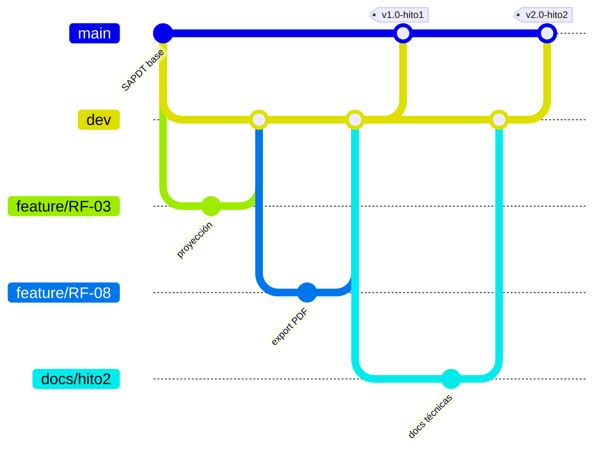

# SAPDT — Plan de gestión de configuración del software (SCM)

Basado en IEEE Std 828 (gestión de configuración) y adaptado a un equipo de 5 personas con Git y GitHub.
Repositorio: https://github.com/leonardouwz/sapdt

## 1. Elementos de configuración (EC)
Todo lo que se versiona y se entrega está en el repositorio. Nada se entrega desde una carpeta local.

| EC | Ubicación | Responsable |
|----|-----------|-------------|
| Código del backend (carga, cruce, análisis, API) | `backend/sapdt/` | Piero, Davis, Katherine |
| Pruebas del backend | `backend/tests/` | Nicolle |
| Código del frontend | `frontend/src/` | Leonardo |
| Pruebas del frontend | `frontend/src/test/` | Nicolle |
| Datos crudos (MINCETUR) | `backend/datos_crudos/` | Piero |
| Base de datos generada | `backend/bd/sapdt.db` | Davis |
| Reportes de calidad y cruce | `backend/reporte_calidad.md`, `backend/reporte_cruce.md` | Piero, Davis |
| Infraestructura (Docker, despliegue) | `backend/Dockerfile`, `frontend/Dockerfile`, `DEPLOY.md`, `frontend/.env.production` | Leonardo |
| Documentación técnica | `README.md`, `docs/` | Nicolle |
| Diagramas (fuente y PNG) | `docs/diagramas/fuentes/*.puml`, `docs/diagramas/*.png` | Nicolle |

Fuera del control de versiones (`.gitignore`): `node_modules/`, salidas de compilación y archivos de entorno con secretos. La URL de la API en `.env.production` no es un secreto y sí se versiona.

## 2. Estrategia de ramas



| Rama | Uso | Regla |
|------|-----|-------|
| `main` | Versión estable, la que está desplegada en Cloud Run | Solo recibe merges por pull request revisado; cada entrega lleva etiqueta |
| `dev` | Integración de lo terminado en el sprint | Las pruebas deben pasar antes de pasar a `main` |
| `feature/RF-0X-descripcion` | Un requisito funcional | Sale de `dev` y vuelve a `dev` por PR |
| `fix/descripcion` | Corrección de un defecto | Igual que `feature/` |
| `docs/descripcion` | Documentación | Igual que `feature/` |

> Estado real: el código del Hito 1 se integró directamente en `main` (4 commits del 12-oct al 19-nov-2026), porque se trabajó en un solo equipo local. Desde el Hito 2 los cambios entran por pull request, empezando por esta documentación.

## 3. Convención de commits
Mensaje en español, en presente, que diga qué cambia y por qué. Si toca un requisito, se nombra el RF:
```
RF-03: agrega modelo estacional ingenuo a la proyección
fix: el CSV del comparador perdía las tildes en Excel
docs: matriz de trazabilidad para el Hito 2
```

## 4. Control de cambios (pull requests)
1. Se crea la rama desde `dev` (o `main` mientras no exista `dev`).
2. Se abre un PR que indica el RF o defecto, qué cambió y cómo se probó.
3. Revisión de al menos **1 compañero** distinto del autor.
4. Lista de verificación antes de aprobar:
   - Las pruebas del backend (`python -m tests.test_*`) y del frontend (`npx vitest run`) pasan.
   - Si cambia un requisito, se actualiza el [catálogo](01_catalogo_requisitos_final.md) y la [matriz de trazabilidad](07_matriz_trazabilidad.md).
   - No hay credenciales ni datos personales nuevos en el diff.
5. Merge con "Squash and merge" o "Merge commit"; se borra la rama.

Un cambio a un requisito ya aprobado (por ejemplo, quitar RF-08 PDF) lo decide el equipo en la reunión semanal y queda en el acta y en el PR.

## 5. Versionado y releases
Versionado semántico simplificado `vMAYOR.MENOR`, una versión mayor por hito:

| Etiqueta | Commit | Contenido |
|----------|--------|-----------|
| `v1.0-hito1` | `ea9c18a` (12-oct-2026) | RF-01 a RF-08 funcionando, desplegado en Cloud Run |
| `v1.1` | `26fd8ee` (19-nov-2026) | README para la feria con capturas |
| `v2.0-hito2` | merge de este PR y del artículo final | Documentación técnica completa, artículo IEEE, diapositivas |

Crear una etiqueta y su release (lo hace el responsable de calidad):
```
git tag -a v2.0-hito2 -m "Entrega del Hito 2"
git push origin v2.0-hito2
```
En GitHub: **Releases → Draft a new release**, elegir la etiqueta y adjuntar el artículo IEEE (PDF) y las diapositivas.

## 6. Auditoría de configuración
Antes de cada entrega se comprueba:
- La versión etiquetada en `main` es la misma que está desplegada (`gcloud run services describe sapdt-api --region us-central1`).
- `README.md` enlaza toda la documentación y las URLs en línea responden.
- Las pruebas pasan sobre la etiqueta (resultado anotado en la [matriz](07_matriz_trazabilidad.md#4-resultado-de-la-última-ejecución)).
