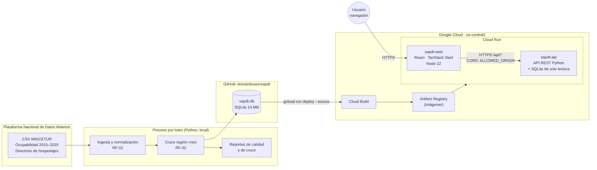
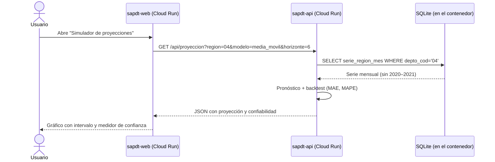

# SAPDT — Arquitectura en la nube

Plataforma: **Google Cloud**, proyecto `sapdt-lasalle`, región `us-central1`. Pasos de despliegue en [`DEPLOY.md`](../DEPLOY.md).

## 1. Vista general

## 2. Componentes

| Componente | Tecnología | Responsabilidad | RF |
|------------|------------|-----------------|----|
| Ingesta | Python 3.12, solo biblioteca estándar | Detecta codificación, separador y esquema por año; valida, repara y registra rechazos | RF-01 |
| Cruce | Python + SQLite | Une la serie por departamento (código UBIGEO) con el directorio; lista huérfanos | RF-02 |
| Base de datos | SQLite (archivo en la imagen) | Tablas `ocupabilidad`, `directorio`, `cargas`, `rechazos`, `serie_region_mes`, `directorio_por_region` | — |
| `sapdt-api` | Python `http.server` en Cloud Run (256 MiB) | Endpoints `/api/regiones`, `/series`, `/temporada`, `/proyeccion`, `/comparativo`, `/establecimientos`, `/export/{reporte}` (CSV y PDF) | RF-03 a RF-08 |
| `sapdt-web` | React + TanStack Start, servidor Node en Cloud Run (512 MiB) | Dashboard, tendencias, simulador, comparador, directorio | RF-03 a RF-08 |
| Cloud Build + Artifact Registry | Servicios gestionados de Google | Compilan cada `Dockerfile` y guardan la imagen | — |

## 3. Flujo de una consulta

## 4. Decisiones de arquitectura

| Decisión | Alternativa descartada | Motivo |
|----------|------------------------|--------|
| SQLite empaquetado en la imagen de la API | Cloud SQL (PostgreSQL), que era el diagrama del Hito 1 | Los datos son de solo lectura y pesan 14 MB; evita costo mensual y migración. Revisar si se cargan datos nuevos a diario |
| Cloud Run (contenedores sin servidor) | Compute Engine o App Engine | Escala a cero cuando nadie lo usa (costo casi nulo para el curso) y despliega desde el código fuente |
| API con biblioteca estándar de Python | Flask o FastAPI | Sin dependencias que instalar ni mantener; imagen más pequeña |
| Datos crudos versionados en GitHub | Cloud Storage | Tamaño pequeño; la carga es reproducible desde el repositorio |
| Dos servicios separados (API y web) | Un solo servicio | Se pueden desplegar y escalar por separado; la API queda cerrada a la interfaz con CORS |

## 5. Seguridad y configuración
- La API solo acepta peticiones del navegador desde la URL de la interfaz (`ALLOWED_ORIGIN`).
- Configuración solo por variables de entorno (`HOST`, `PORT`, `ALLOWED_ORIGIN`, `VITE_API_BASE_URL`); no hay credenciales en el repositorio (RNF-06).
- La base es de solo lectura: la API no tiene ningún endpoint que escriba.
- HTTPS lo pone Cloud Run de forma gestionada.

## 6. URLs
- Interfaz: https://sapdt-web-606560700752.us-central1.run.app
- API: https://sapdt-api-606560700752.us-central1.run.app/api/regiones/04

Diagrama de componentes original (PlantUML, Hito 1): [`diagramas/CS_HITO1_componentes.png`](diagramas/CS_HITO1_componentes.png).
