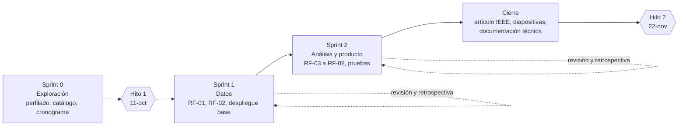

# SAPDT — Modelo de proceso de software

## 1. Modelo elegido: incremental con Scrum adaptado
Se trabajó en incrementos cortos (sprints), cada uno con un producto que funciona y se puede revisar. Las prácticas de Scrum se adaptaron a un equipo universitario de 5 personas con dos hitos de revisión.

**Por qué este modelo y no cascada:**
1. La calidad real de los datos del portal solo se conocía explorándolos. Hacía falta un Sprint 0 de perfilado antes de fijar los requisitos.
2. El curso tiene dos hitos (40–60 % y 100 %), que encajan con entregas incrementales verificables.
3. Permite ajustar el catálogo después de cada incremento sin rehacer todo el plan (por ejemplo, el cambio de Cloud SQL a SQLite).
4. Se perdieron las semanas 1–4; con incrementos se recuperó trabajando en paralelo (RF-01 y RF-02 a la vez) en lugar de alargar el calendario.

## 2. Ciclo seguido

| Sprint | Semanas | Entrega | Evidencia en el repositorio |
|--------|---------|---------|-----------------------------|
| 0 — Exploración | 5 (5–11 oct) | Perfilado de datasets, catálogo de 8 RF, cronograma, diagramas | `docs/01`–`06`, `docs/diagramas/` |
| 1 — Datos | 6 (12–18 oct) | Ingesta, cruce y primer despliegue en Cloud Run | `backend/sapdt/ingesta.py`, `cruce.py`, `DEPLOY.md` |
| 2 — Análisis y producto | 7–10 (19 oct–15 nov) | Proyección, temporadas, comparador, directorio, series, exportación | `backend/sapdt/analisis.py`, `api.py`, `frontend/src/routes/` |
| Cierre | 11 (16–22 nov) | Artículo IEEE, diapositivas, README, documentación técnica | `README.md`, `docs/07`–`11` |

Cronograma detallado, diagrama de Gantt y riesgos: [`03_cronograma_roles_proceso.md`](03_cronograma_roles_proceso.md) y [`diagramas/CS_HITO1_gantt.png`](diagramas/CS_HITO1_gantt.png).

## 3. Roles

| Rol Scrum | Persona | Frente |
|-----------|---------|--------|
| Product Owner | Leonardo Pachari Gomez | Producto y reportes (RF-05 a RF-08) |
| Scrum Master / QA | Nicolle Lozano Vega | Calidad, pruebas y documentación |
| Equipo de desarrollo | Piero Poblete Andía | Ingesta y normalización (RF-01) |
| Equipo de desarrollo | Davis Arapa Chua | Cruce por región y mes (RF-02) |
| Equipo de desarrollo | Katherine Saico Ccahuana | Análisis y proyección (RF-03, RF-04) |

## 4. Artefactos y eventos

| Elemento | Cómo se aplicó |
|----------|----------------|
| Product backlog | [Catálogo de requisitos](01_catalogo_requisitos_final.md) con prioridad MoSCoW y sprint asignado |
| Sprint backlog | Tablero con una tarjeta por RF (Backlog / En curso / En pruebas / Hecho) |
| Definición de "hecho" | El RF cumple sus criterios de aceptación, tiene prueba automática que pasa y aparece en la [matriz de trazabilidad](07_matriz_trazabilidad.md) |
| Reunión semanal | 15–20 min, acta de 3 líneas: hecho / por hacer / bloqueos |
| Revisión de sprint | Demostración del incremento desplegado en Cloud Run |
| Retrospectiva | Ajustes del plan: recuperar semanas perdidas en paralelo; cambiar Cloud SQL por SQLite |
| Incremento | Versión etiquetada en GitHub (ver [gestión de configuración](08_gestion_configuracion.md#5-versionado-y-releases)) |
